# VisionInspect

C# WPF 기반 산업용 머신비전 검사 및 AI 이상 탐지 모델 비교 프로젝트입니다. OpenCvSharp를 활용한 7종 영상처리 알고리즘과 AI 모델 비교·성능 분석 화면을 제공합니다.

## 기술 스택

- **Desktop:** C#, WPF, XAML, MVVM, CommunityToolkit.Mvvm
- **Computer Vision:** OpenCvSharp / OpenCV
- **AI 서버:** Python, FastAPI, PyTorch, anomalib, OpenCV, NumPy, Pillow
- **AI 이상 탐지 모델:** PatchCore, PaDiM, EfficientAD
- **평가 데이터:** MVTec AD (화면에 표시된 테스트 기준)

## 시스템 아키텍처

VisionInspect는 **WPF 화면(View)과 검사 상태·명령(ViewModel), 영상처리 로직(Service/Algorithm)을 분리**한 데스크톱 애플리케이션입니다. OpenCV 검사와 AI 모델 비교·벤치마크는 별도 화면으로 제공됩니다.

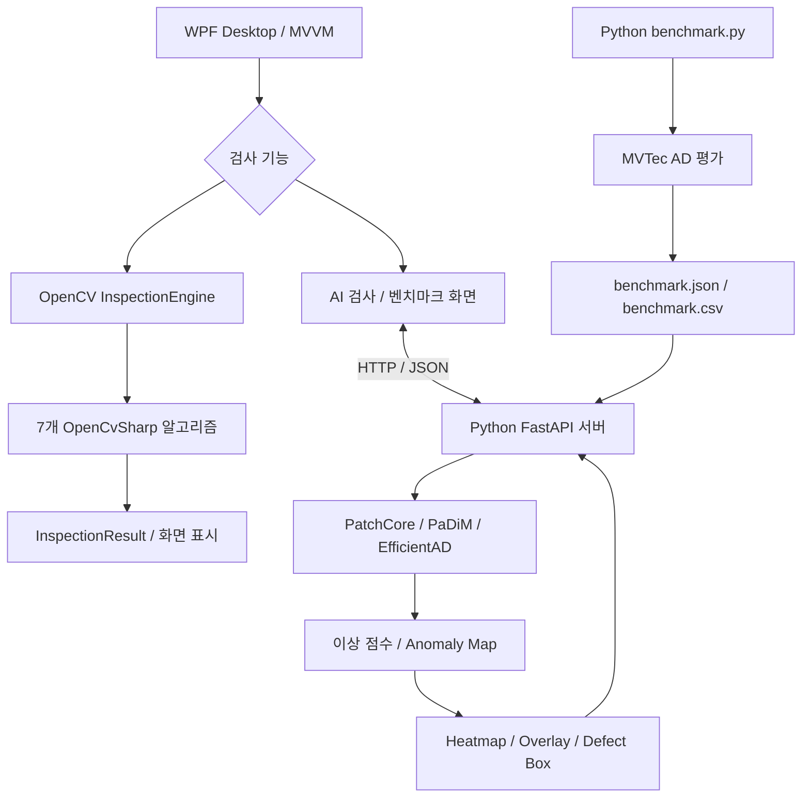

### OpenCV 모듈 구조

아래는 **확인된 주요 클래스의 논리적 구성**입니다. 실제 저장소의 전체 디렉터리 트리를 그대로 복제한 것은 아닙니다.

```text
VisionInspect
└── VisionInspect.WPF
    ├── OpenCvInspectionWindow.xaml          # 검사 화면 및 데이터 바인딩
    ├── OpenCvInspectionViewModel.cs         # 입력 이미지, 설정값, 검사 실행 명령
    └── Services
        └── OpenCv
            ├── InspectionEngine             # 선택한 알고리즘 실행 및 결과 전달
            ├── IInspectionAlgorithm         # 검사 알고리즘 공통 인터페이스
            ├── InspectionSettings           # 알고리즘별 파라미터
            ├── InspectionResult             # 상태, 점수, 시간, 이미지, 결함 정보
            ├── DifferenceInspection         # 기준 이미지 차이 검출
            ├── ShapeInspection              # 객체 윤곽·형상 분석
            ├── TemplateInspection           # 템플릿 다중 매칭
            ├── DimensionInspection          # 치수 및 회전 각도 측정
            ├── SurfaceInspection            # 표면 이상 영역 검출
            ├── ColorInspection              # HSV 색상 검사
            └── FeatureInspection            # ORB 특징점 매칭
```

### Python AI 모듈 구조 (실제 GitHub 저장소 기준)

```text
VisionInspect.AI/
├── api/
│   └── api_server.py           # FastAPI: 모델 로딩, 이미지 추론, 결과 조회
├── scripts/
│   ├── train_patchcore.py      # PatchCore 학습 스크립트
│   ├── train_padim.py          # PaDiM 학습 스크립트
│   ├── train_efficientad.py    # EfficientAD 학습 스크립트
│   └── benchmark.py            # MVTec AD 모델 성능 평가 및 리포트 생성
├── gpu_test.py                 # CUDA/GPU 환경 확인
├── requirements.txt           # Python 의존성 파일 (현재 저장소에서는 비어 있음)
└── test.py                    # 테스트용 파일 (현재 저장소에서는 비어 있음)

# 실행 중 생성/참조하는 경로 (저장소에 포함되지 않을 수 있음)
# datasets/MVTecAD/           # 평가 데이터셋
# outputs/.../model.ckpt       # 모델별 학습 체크포인트
# outputs/benchmark/...        # 평가 결과 JSON / CSV
# results/                     # 추론 입력 및 결과 이미지
```

#### AI 모델 학습 및 로딩

`train_patchcore.py`, `train_padim.py`, `train_efficientad.py`는 모델별 학습을 위한 진입점입니다. API 서버는 `outputs/`에 저장된 각 모델의 Lightning 체크포인트(`model.ckpt`)를 로딩합니다. 서버 시작 시 `torch.cuda.is_available()`로 GPU 사용 가능 여부를 확인하고, 체크포인트가 존재하는 모델만 메모리에 로딩합니다. 현재 API의 체크포인트 경로는 **MVTec AD의 `transistor` 카테고리**를 기준으로 지정되어 있습니다.

#### Python API 기반 AI 검사 처리 흐름

1. WPF AI 검사 화면에서 검사 이미지와 모델을 선택합니다.
2. Python FastAPI의 `POST /api/inspect?model=...`에 이미지를 업로드합니다.
3. Pillow로 이미지를 RGB로 변환하고 임시 입력 이미지를 저장합니다.
4. anomalib `Engine.predict()`를 통해 선택한 모델로 추론합니다. 동시 추론 충돌을 피하기 위해 잠금(`Lock`)을 사용합니다.
5. `pred_score`, `pred_label`, 모델의 `image_threshold`를 확인하여 OK/NG를 판정합니다.
6. `anomaly_map`을 원본 이미지 크기로 조정하고 OpenCV로 Heatmap, Overlay, 결함 Bounding Box 이미지를 생성합니다.
7. JSON 응답으로 이상 점수, 판정, 추론 시간, 결함 목록, 결과 이미지 경로를 전달합니다. WPF는 이를 화면에 표시합니다.

**주요 API**

| 엔드포인트 | 기능 |
|---|---|
| `GET /api/health` | 서버 상태, 로딩된 모델, CPU/GPU 정보 조회 |
| `POST /api/inspect?model=patchcore` | 이미지 업로드 및 선택 모델 추론 (`padim`, `efficientad` 지원) |
| `GET /api/benchmark/latest` | 가장 최근 벤치마크 JSON 결과 조회 |
| `GET /results/...` | 생성된 Heatmap, Overlay, 결함 표시 이미지 제공 |

> **구현 구분:** 이미지의 최종 OK/NG는 모델의 예측 레이블 또는 모델 임계값으로 결정합니다. 결함 박스를 만드는 정규화된 Anomaly Map의 `0.55` 기준은 **시각화 전용**이며, 모델 판정 임계값과 다릅니다. 따라서 화면의 결함 박스 개수와 OK/NG가 반드시 일치하지는 않습니다.

#### AI 벤치마크 처리 흐름

`benchmark.py`는 `MVTecAD` 데이터 모듈과 anomalib `Engine.test()`를 사용해 모델별 평가를 실행합니다. 평가 과정에서 Image AUROC, Image F1, Pixel AUROC, Pixel F1 및 **모델별 전체 평가 소요 시간**을 수집합니다. 결과는 `outputs/benchmark/<카테고리_실행시각>/benchmark.json`과 `benchmark.csv`로 저장하고, FastAPI의 `/api/benchmark/latest`에서 최신 JSON을 제공합니다.

**참고:** 평가 시간은 단일 이미지 추론 지연 시간이 아니라 모델 평가 실행 구간의 소요 시간입니다. 모델 가중치와 MVTec AD 데이터셋은 별도로 준비해야 합니다.

### 검사 실행 데이터 흐름

1. **View:** 사용자가 알고리즘과 이미지를 선택하고 파라미터를 입력합니다.
2. **ViewModel:** 입력값을 `InspectionSettings`로 구성하고 검사 실행을 요청합니다.
3. **InspectionEngine:** 선택한 `InspectionMode`에 대응하는 알고리즘에 이미지와 설정을 전달합니다.
4. **Algorithm:** OpenCvSharp로 전처리·검출·측정·판정을 수행합니다.
5. **InspectionResult:** `OK/NG/ERROR`, 점수, 처리 시간, 원본·결과·처리 이미지, 결함 목록을 반환합니다.
6. **ViewModel → View:** 결과를 바인딩하여 이미지, 판정 배지, 결함 좌표와 검사 지표를 갱신합니다.

### 설계 포인트

- **알고리즘 분리:** 7개 검사 방식이 공통 인터페이스를 구현하므로 화면 로직과 검사 로직의 결합을 줄였습니다.
- **설정 일원화:** `InspectionSettings`에 모드별 임계값과 측정 조건을 정의해 화면에서 조정합니다.
- **결과 표준화:** `InspectionResult` 형식으로 검사 방식에 관계없이 동일한 결과 패널을 사용합니다.
- **기준 이미지 선택적 사용:** Difference·Template·Feature는 기준 이미지를 활용하며 나머지 모드는 단일 이미지와 검사 규격으로 동작합니다.
- **AI 평가 기능 분리:** AI 모델 비교 화면은 개별 이미지 추론 결과를, 벤치마크 화면은 데이터셋 기반 평가 지표를 보여줍니다. Python 서버와 학습·벤치마크 스크립트는 별도 `VisionInspect.AI` 디렉터리로 분리했습니다.

## 주요 화면 및 구현 로직

### 01. AI 모델 비교

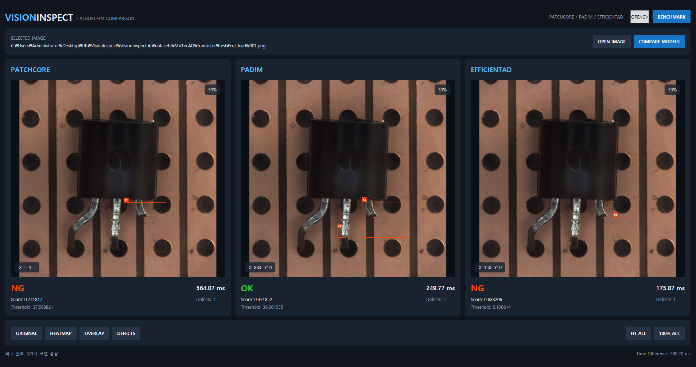

PatchCore, PaDiM, EfficientAD를 동일한 검사 이미지에 적용해 이상 점수와 임계값으로 OK/NG를 판정하고, 결함 영역·추론 시간·결함 개수를 나란히 비교합니다. 화면에서 Original / Heatmap / Overlay / Defects 보기 방식을 전환할 수 있습니다.

### 02. AI 성능 벤치마크

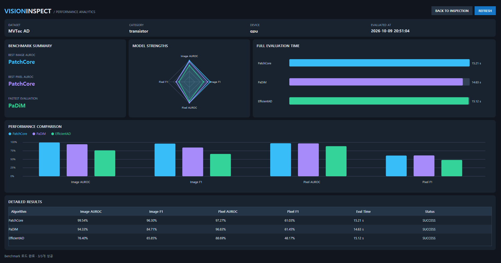

MVTec AD 데이터셋을 대상으로 모델별 Image AUROC, Image F1, Pixel AUROC, Pixel F1 및 평가 시간을 집계해 차트와 테이블로 비교합니다. 표시된 수치는 화면의 평가 실행 결과이며, 전체 데이터셋에 대한 보편적인 성능을 의미하지 않습니다.

### 03. OpenCV 통합 검사 화면

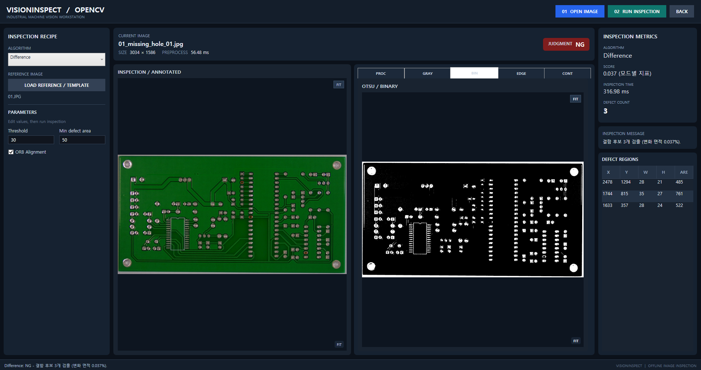

WPF와 MVVM으로 검사 설정·이미지 표시·결과 지표를 분리했습니다. 검사 모드별 설정을 받아 OpenCvSharp 알고리즘을 실행하고, 원본/주석 이미지 및 전처리 결과(Gray, Binary, Edge, Contour 등)를 확인할 수 있습니다.

### 04. Difference — 이미지 차이 검사

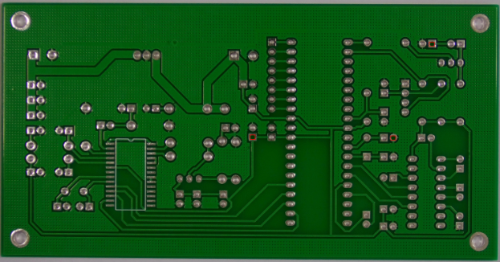

기준 이미지와 검사 이미지의 위치 차이를 ORB 특징점과 RANSAC으로 보정한 뒤, 픽셀 차이(AbsDiff)를 임계값 처리합니다. 형태학적 연산과 윤곽선 분석으로 차이 영역을 추출하고 면적 기준에 따라 NG를 판정합니다.

### 05. Shape — 형상 검사

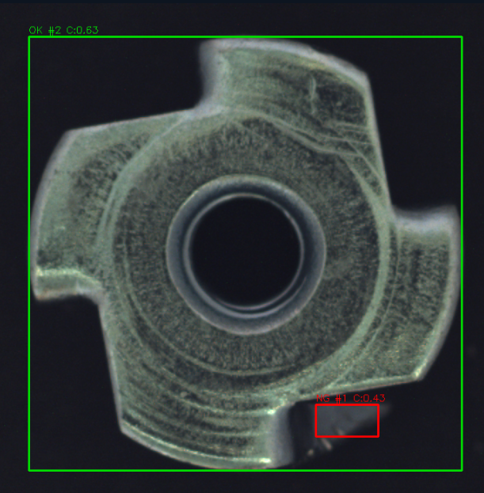

그레이스케일·Otsu 이진화·형태학적 연산으로 객체를 분리하고, 윤곽선에서 면적·외곽 크기·원형도 등 형상 특징을 계산합니다. 지정한 허용 범위를 벗어나는 객체를 표시합니다.

### 06. Template — 패턴 매칭

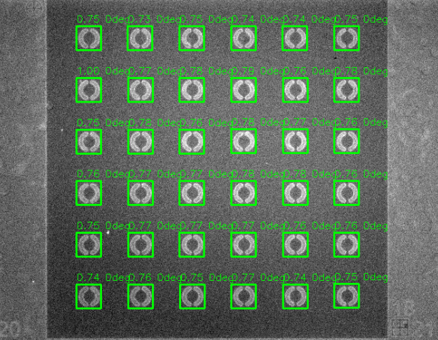

기준 템플릿을 검사 이미지에서 정규화 상관계수 기반으로 검색합니다. 유사도 임계값을 통과한 후보에 NMS(중복 제거)를 적용해 동일 패턴의 여러 위치를 검출하고, 필요하면 예상 개수와 비교합니다.

### 07. Dimension — 치수 검사

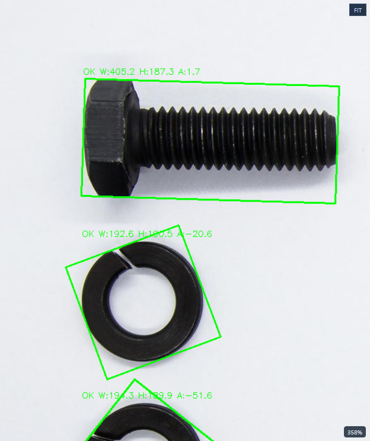

이진화와 윤곽선 검출로 물체를 분리하고 MinAreaRect로 회전 외접 사각형을 계산합니다. 너비·높이·회전 각도를 측정하여 설정한 허용 범위와 비교하며, 보정 계수가 있으면 픽셀 길이를 실제 단위로 환산할 수 있습니다.

### 08. Surface — 표면 결함 검사

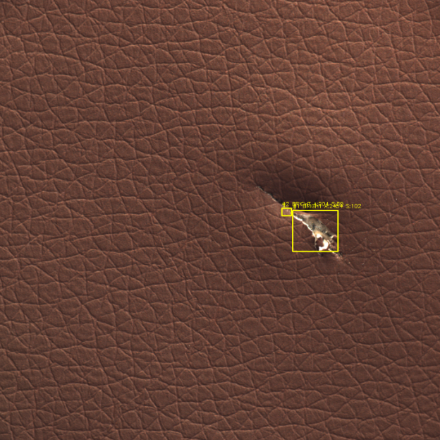

TopHat과 BlackHat으로 주변 표면보다 밝거나 어두운 국소 영역을 강조합니다. 임계값·형태학적 연산·최소 면적 필터로 후보를 정제해 스크래치나 찢어짐 등 표면 이상을 표시합니다.

### 09. Color — 색상 검사

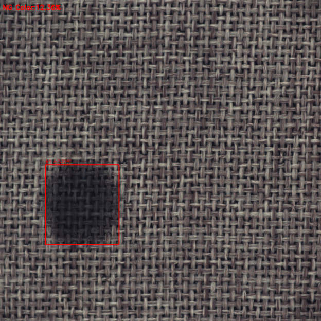

BGR 이미지를 HSV로 변환한 후 Hue·Saturation·Value 범위를 InRange로 마스킹합니다. 검출 픽셀 비율과 영역을 계산하고 금지 색상 또는 필수 색상 조건에 따라 판정합니다. 어두운 얼룩은 Value 상한을 낮춰 검출할 수 있습니다.

### 10. Feature — 특징점 매칭

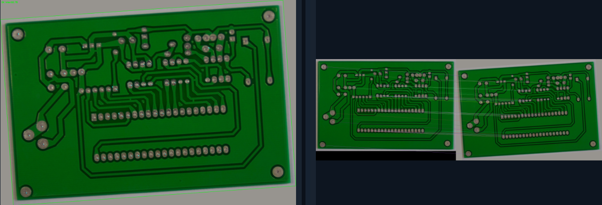

기준 이미지와 검사 이미지에서 ORB 특징점·기술자를 추출하고 BFMatcher 및 Lowe Ratio Test로 대응점을 선별합니다. RANSAC Homography와 Inlier 비율로 매칭 신뢰도를 판단하고, 인식된 대상의 투영 외곽선과 대응점을 시각화합니다. 개별 부품 결함을 직접 검출하는 기능은 아닙니다.

## 검사 처리 흐름

`이미지 입력 → 알고리즘/파라미터 선택 → 전처리 → 특징 추출·결함 후보 검출 → 규격/임계값 판정 → 결과 시각화 및 지표 표시`

기준 이미지는 Difference, Template, Feature 검사에서 필요하며, Shape·Dimension·Surface·Color 검사는 설정값을 기준으로 단일 이미지 검사가 가능합니다.